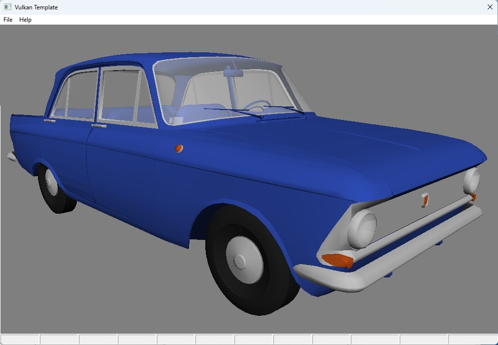
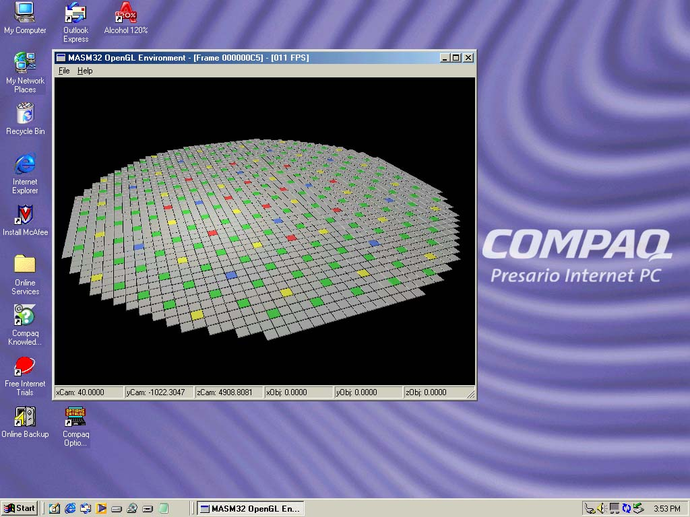
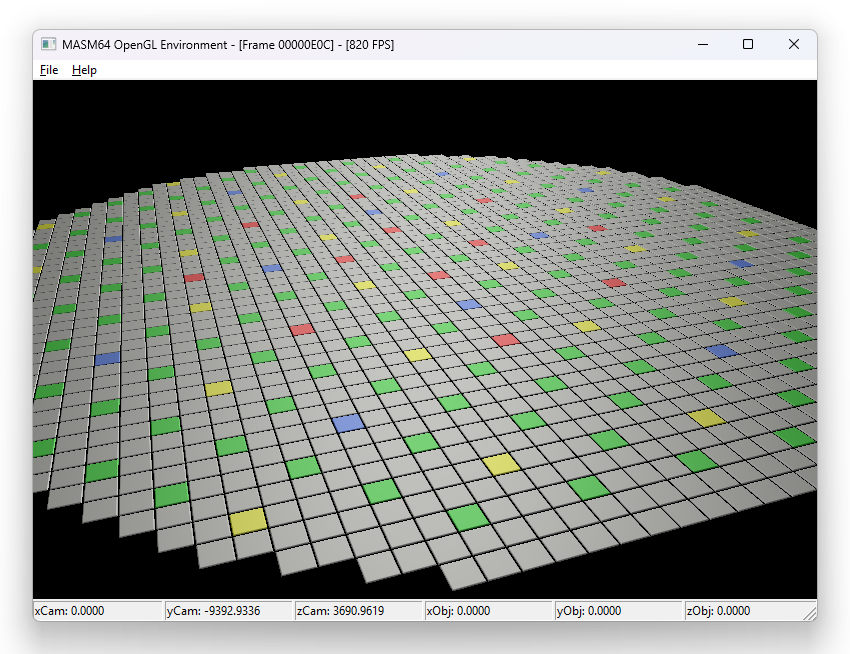

# Singeleitsev

## Vulkan application in pure MASM

A full-stack Windows Vulkan engine written in **pure assembly**

- **Vulkan MASM engine source:** [win64/41_m408vk](https://github.com/Singeleitsev/asm/tree/master/win64/41_m408vk/b083)

  
  

  <em>Left: Screenshot. Right: Render.</em>

## RBMK64 & RBMK32 — OpenGL Engines in Pure MASM

RBMK64 and RBMK32 are two Windows OpenGL programs, both written in **pure assembly** using the **Microsoft MASM toolchain**.

They are **not a port**. They are two independent implementations of the same design, written in two different assembly dialects, with different ABIs, different toolchains, and different GL pipelines underneath.

- **RBMK32 source:** [win32/05_RBMK](https://github.com/Singeleitsev/asm/tree/master/win32/05_RBMK/)
- **RBMK64 source:** [win64/30_RBMK/02_SDI](https://github.com/Singeleitsev/asm/tree/master/win64/30_RBMK/02_SDI)

  
  

  <em>Left: RBMK32 on period-correct hardware. Right: RBMK64 rendering at 820 FPS.</em>

