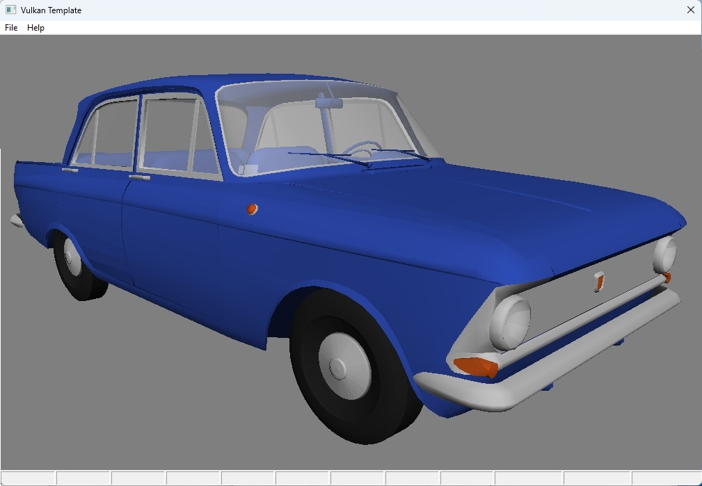

# Vulkan application in pure MASM

A full-stack Windows Vulkan engine written in **pure assembly**

- **Vulkan MASM engine source:** [win64/40_m408](https://github.com/Singeleitsev/asm/tree/master/win64/41_m408vk/)

  
  

  <em>Left: Screenshot. Right: Render.</em>

